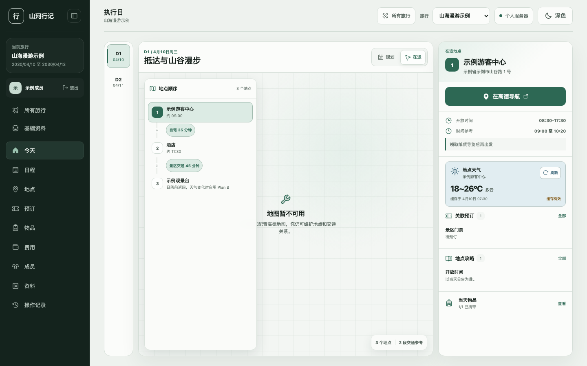
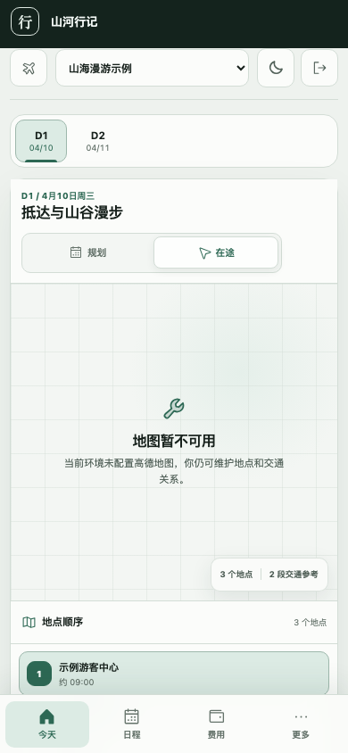
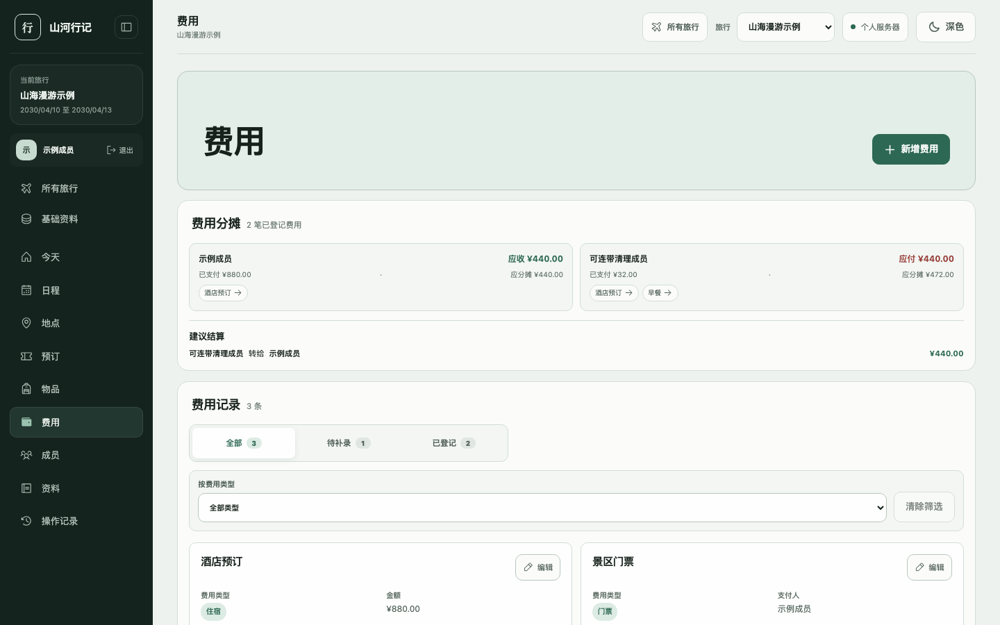
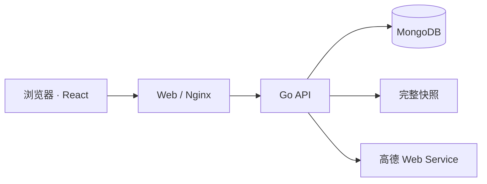

# Atlasloom

> Weave places into days. Keep the journey yours.

**Atlasloom（山河行记）** 是一个中文优先、自托管的个人旅行控制台。它把散落的地点、
交通、预订、费用、物品、天气和攻略，编织成每天真正可执行的旅程。

[](https://github.com/PigRZ/atlasloom/actions/workflows/ci.yml)
[](LICENSE)

```text
哪一天？   Day
去哪里？   Day 中有序排列的 Place
怎么行动？ Place 之间的 Segment
还要处理？ Booking / Expense / PackingItem / ResearchEvidence
```

Atlasloom 不是把行程塞进一张越来越长的表格。它用日期作为主导航、地点作为资料核心，
在出发前帮助你整理计划，在旅行当天只呈现此刻需要的信息。地点顺序是建议，时间和交通
参考按需补充，不会因为计划没有精确到分钟就把旅行判定为“未完成”。

## 界面预览

下图由 Playwright 使用纯虚构数据生成，不包含维护者的真实行程、成员或费用信息。

<p>
  
  
</p>



## 它能做什么

- 用“规划 / 在途”双模式组织当天地点：搜索或落点、调整顺序，并维护相邻地点的交通参考。
- 在一个地点上下文中查看导航、天气、开放时间、关联订单、攻略和当天物品。
- 管理预订、自动关联待登记费用、多人分摊结算、行李物品和来源资料。
- 跨旅行复用成员与地点、费用、平台类型标签；每个 Place 仍明确属于一个 Trip。
- 每次业务写入都校验并发基准，在 MongoDB 事务内生成所属聚合的完整快照。
- 将单次旅行导出为自包含 JSON，经成员/标签映射预览后导入为一场新旅行。
- 通过项目级 AI Skills 调研公开资料、核对高德地点与路线，再由人确认后生成可导入计划。

## 适合谁

Atlasloom 目前优先服务中国大陆旅行场景：界面使用中文，地图与天气优先接入高德，默认
时区和币种是 `Asia/Shanghai`、`CNY`，登录标识目前为 11 位手机号。如果你希望自己
掌握旅行资料、愿意维护一个轻量自托管服务，并且更在意“当天怎么行动”而不只是收藏
地点，它会比较合适。

项目仍在持续演进。准备长期保存真实行程时，请先阅读
[数据工作流](docs/data-workflow.md)并建立独立备份；不要把数据库卷当作唯一备份。

## 五分钟本地启动

需要 Git、Docker Desktop（含 Compose 与 Buildx）和 OpenSSL。普通启动不要求宿主机
安装 Go 或 Node.js；开发测试和 AI 计划编译才需要它们。

```bash
git clone https://github.com/PigRZ/atlasloom.git
cd atlasloom
cp config/project.env.example config/project.env
chmod 600 config/project.env
./scripts/start.sh
```

服务默认只监听本机：

```text
Web      http://127.0.0.1:8501/travel/
API      http://127.0.0.1:8502
MongoDB  仅 Compose 内部网络
```

空数据库首次创建管理员：

```bash
./scripts/travel-api auth bootstrap
./scripts/travel-api auth login
```

本地回环地址下，`auth bootstrap` 会自动读取 `start.sh` 生成且权限为 `600` 的运行时配置；
它只交互询问成员姓名、手机号和两次密码，不显示 bootstrap token。随后打开
<http://127.0.0.1:8501/travel/>。

高德配置、停止与升级、Linux HTTPS 部署等完整说明见
[安装与部署](docs/getting-started.md)。

## 从一场旅行开始

手动流程：

1. 首次 bootstrap 会准备常用平台、地点和费用类型；也可以在基础资料中补充自己的标签。
2. 在“所有旅行”填写名称与日期，系统自动生成日期范围内的每个执行日。
3. 按天收集地点并调整大致顺序，只在需要时补充时间和交通参考。
4. 选择同行成员，补充预订、费用、物品和资料。
5. 出发前从旅行总看板导出一次完整备份。

字段、页面入口、失败语义和验收清单见 [手动创建旅行](docs/manual-trip.md)。

## 用 AI 辅助调研

```text
Agent Reach 多平台检索 + 官方来源
                │
        高德地点路线 + FlyAI 候选
                │
         guide.md（先由用户确认）
                │
         plan.json（严格简化模型）
                │
    ./scripts/travel-plan build <trip-slug>
                │
 trip-backup.json → 预览映射 → 明确确认导入
```

完整流程见 [使用 AI 创建旅行](docs/ai-trip.md)。联网检索能力使用开源项目
[Agent Reach](https://github.com/Panniantong/Agent-Reach)。本仓库在
`.agents/skills/agent-reach/` 中保留其完整 Skill、路由参考和上游 MIT License；
Agent Reach CLI、浏览器扩展和各平台登录态仍需使用者自行安装，不随本仓库分发。

AI 输出始终只是候选资料：涉及票价、营业时间、交通班次和预订的内容，应在使用前回到
官方来源复核；计划导入必须经过预览和明确确认。

## 架构



- 浏览器只调用 Go API，不直接访问 MongoDB 或高德 Web Service Key。
- Web 与 API 只绑定回环端口，MongoDB 不映射宿主机端口；远程访问由宿主机 Nginx 暴露 HTTPS。
- MongoDB 是运行时数据源；业务写入在事务内完成，并同时生成完整快照。
- 代码发布与攻略数据同步是两条独立、可回滚的链路，重新部署不会导入或重置旅行数据。

```text
api/            模块化 OpenAPI paths 与 components
server/         Go API、领域模型、MongoDB 仓库、离线 travelctl
web/            React 控制台
scripts/        启动、验证、数据同步和发布入口
.agents/skills/ 项目级互联网检索、旅行调研与 AI 初始化 Skills
config/         无密钥配置模板
docs/           使用手册、模型、数据与运维文档
```

主要技术栈是 React 19、TypeScript、Vite、Go 1.26、MongoDB 8 和 Docker Compose。

## 数据、隐私与安全

代码仓库不包含业务数据库、真实旅行快照或可用凭据。以下内容永远不应进入 Git、Issue、
PR 日志或公开压缩包：

- `config/project.env`、`config/users.json`
- `.local/`、`.deploy/`、`backups/`、`snapshots/`
- 密码、Key、Token、Cookie、证书私钥和二维码
- 真实旅行快照、成员联系方式、订单与费用明细

提交前可运行当前树隐私门禁：

```bash
./scripts/check-public-tree.sh
```

它只检查 Git 跟踪文件且不回显本机受限配置的真实值。安全问题请不要创建公开 Issue，
请按 [安全策略](SECURITY.md) 中的私密渠道报告。

## 开发与验证

完整本地验证需要 Go 1.26、Node.js 24+ 和可用 Docker：

```bash
./scripts/test.sh
BOOTSTRAP_TOKEN=static-check docker compose config
```

页面改动还需验证桌面与 390px 视口：

```bash
cd web
npm run test:e2e
```

README 截图只允许使用 E2E 虚构数据；界面稳定后可重复生成：

```bash
cd web
npm run docs:screenshots
```

容器或发布链路改动还需运行 `./scripts/test-compose-smoke.sh`。`test.sh` 覆盖公开树隐私
门禁、Shell/运维契约、Go 单测与覆盖率、真实 MongoDB 事务和 validator、OpenAPI、
前端类型/DOM/覆盖率/build/lint/audit。

贡献前请阅读 [贡献指南](CONTRIBUTING.md)。领域和接口变更还需要同步
[数据模型](docs/data-model.md)与[系统架构](docs/architecture.md)。

## 文档

- [安装与部署](docs/getting-started.md)
- [手动创建旅行](docs/manual-trip.md)
- [使用 AI 创建旅行](docs/ai-trip.md)
- [系统架构](docs/architecture.md)
- [数据模型](docs/data-model.md)
- [真实数据工作流](docs/data-workflow.md)
- [高级运维、发布与恢复](docs/operations.md)
- [安全策略](SECURITY.md)
- [开源发布与隐私检查](docs/open-source-release.md)

## License

Atlasloom 以 [MIT License](LICENSE) 发布。外部 CLI、平台服务和第三方依赖仍分别受其
自身许可证与服务条款约束，见 [第三方说明](THIRD_PARTY_NOTICES.md)。
